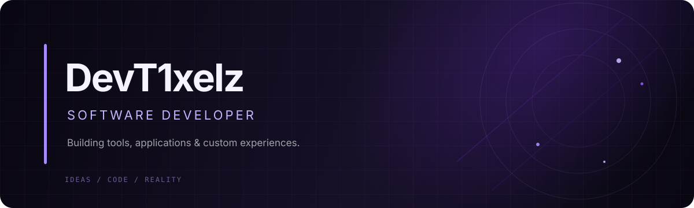

 

### `Software Developer` · `Plugin Developer` · `Builder of tools`

---

## `> whoami`

I'm a developer focused on building software, tools and custom solutions.  
I enjoy turning ideas into practical projects — from backend logic and integrations to desktop applications and Minecraft plugins.

- Building projects with an emphasis on maintainability and usability.
- Exploring application development, automation and server-side systems.
- Always learning, experimenting and improving my workflow.

## `> languages_&_tools`

### Languages

### IDEs & Tools

## `> selected_work`

| Project | Description | Stack |
|:--|:--|:--|
| **TzLauncher** | A desktop launcher project for Minecraft. | Electron · JavaScript |
| **TzStudio** | A set of tools and utilities for development workflows. | Web · JavaScript |
| **PulseSync Together** | A project focused on synchronized music listening. | Node.js |
| **Minecraft Plugins** | Custom gameplay mechanics and server-side tools. | Java · Paper/Spigot |

> Project links can be added once the repositories are public. Replace each project name with its GitHub repository URL when ready.

## `> github_stats`

 

## `> contribution_activity`

---

**`Ideas → Code → Reality`**

Designed with ☾ and a little bit of purple.

